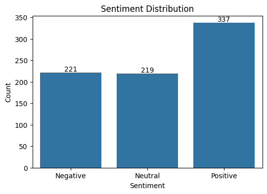
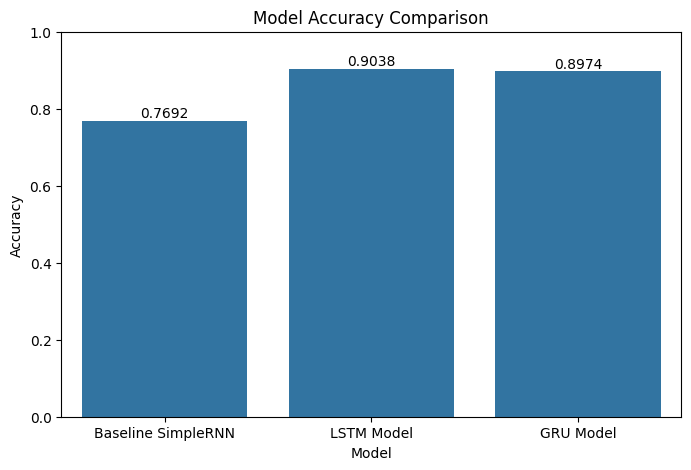
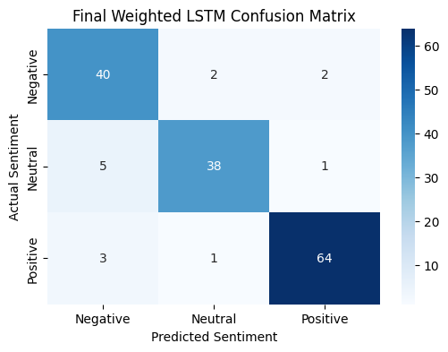

# Pizza Review Sentiment Analysis with RNNs and LSTM

   

**A natural-language processing study comparing recurrent neural network architectures for classifying customer pizza reviews as negative, neutral, or positive.** The project explores multilingual preprocessing, model selection, class weighting, and error analysis.

## Highlights

| Recorded result | Weighted LSTM (historical experiment) |
| --- | ---: |
| Accuracy on the notebook's 156-review test split | **91.03%** |
| Macro F1-score (rounded) | **0.90** |
| Misclassified reviews | **14 / 156** |
| Classes | Negative, Neutral, Positive |

**Evaluation disclosure:** These numbers were recorded in the original coursework notebook. It fitted the text tokenizer to the full dataset **before** the train/test split, and the test split was used in architecture/experiment comparisons. The figures should **not** be treated as a rigorously untouched, leakage-free benchmark. See [Evaluation Notes](EVALUATION_NOTES.md).

## Problem and approach

Customer feedback is often unstructured, making it difficult to summarise sentiment at scale. This project investigates whether recurrent neural networks can distinguish **positive**, **negative**, and **neutral** pizza reviews from review text.

1. **Clean and filter reviews:** validate score values, retain English and Malay reviews, remove duplicate translated review strings.
2. **Translate and preprocess:** translate Malay reviews to English using `deep-translator`, normalise text, tokenise and pad sequences.
3. **Train architectures:** compare SimpleRNN, LSTM, GRU and further LSTM configurations.
4. **Experiment:** assess sentence-level augmentation, English-only vs translated multilingual data, and class-weighted LSTM training.
5. **Evaluate:** compare model metrics, confusion matrices and misclassified reviews.

**Dataset:** 902 records originally loaded; 893 remained after score/language filtering and 777 after translated-review deduplication. The original dataset came from a course assignment and is **not redistributed** here.

## Visual results

### Recorded sentiment distribution



### Model accuracy comparison



### Weighted LSTM confusion matrix



These are exports of the **original notebook plots**, not independently reproduced experiments.

## Tech stack

`Python` · `TensorFlow / Keras` · `scikit-learn` · `Pandas` · `NumPy` · `Matplotlib` · `Seaborn` · `NLTK` · `deep-translator`

## Repository structure

```text
pizza-review-sentiment-lstm/
├── README.md
├── EVALUATION_NOTES.md
├── requirements.txt
├── .gitignore
├── notebooks/
│   └── pizza_review_sentiment_experiments.ipynb
├── assets/
│   ├── sentiment_distribution.png
│   ├── sentiment_by_language.png
│   ├── architecture_accuracy_comparison.png
│   └── weighted_lstm_confusion_matrix.png
└── models/
    ├── README.md
    └── best_weighted_lstm_model.h5
```

## Running the notebook

1. Create a Python environment with a compatible TensorFlow version; see [requirements.txt](requirements.txt).
2. Install dependencies and NLTK resources.
3. With appropriate access/permission, place the source dataset as `Pizza reviews.csv` next to the executed notebook.
4. Run the notebook cells sequentially. Malay translation requires an internet connection on the initial run.

> **Important:** The original coursework dataset, translation cache and fitted tokenizer were not included. Re-running the historical notebook may require adaptations depending on package versions and will not necessarily reproduce its exact numerical results. The saved model is a research artifact, **not a ready-to-use inference service**.

## Key takeaways

- LSTM architectures were effective at learning sentiment from short customer reviews in this experiment.
- Class weighting slightly improved the recorded LSTM evaluation compared with the unweighted configuration.
- Neutral and ambiguous reviews remained challenging; translation and data quality also affected interpretation.
- A stronger follow-up evaluation would fit the tokenizer **only on training data**, use a dedicated validation set for model selection, and evaluate once on an untouched test set.

## About this project

Individual Deep Learning coursework project at Singapore Polytechnic, presented here as a portfolio case study. Coursework-only materials and the original dataset are intentionally excluded. This public package contains the preserved source notebook with outputs cleared, original plots, and the final model artifact; any further release remains subject to relevant coursework/dataset sharing rules.

**Author:** [Yun Fei](https://github.com/tyunfei) · [LinkedIn](https://www.linkedin.com/in/toh-yun-fei/)